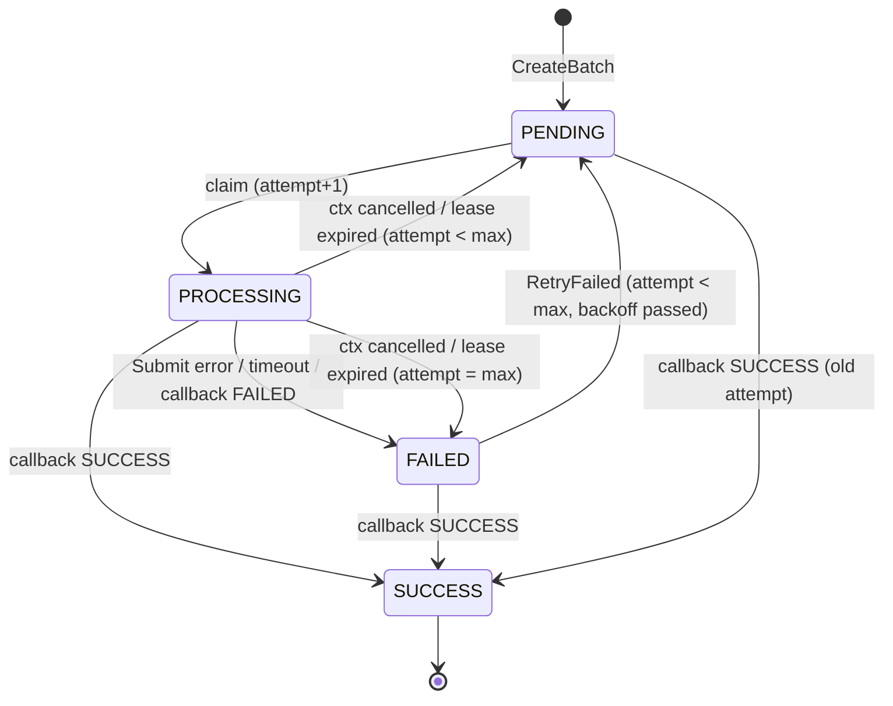
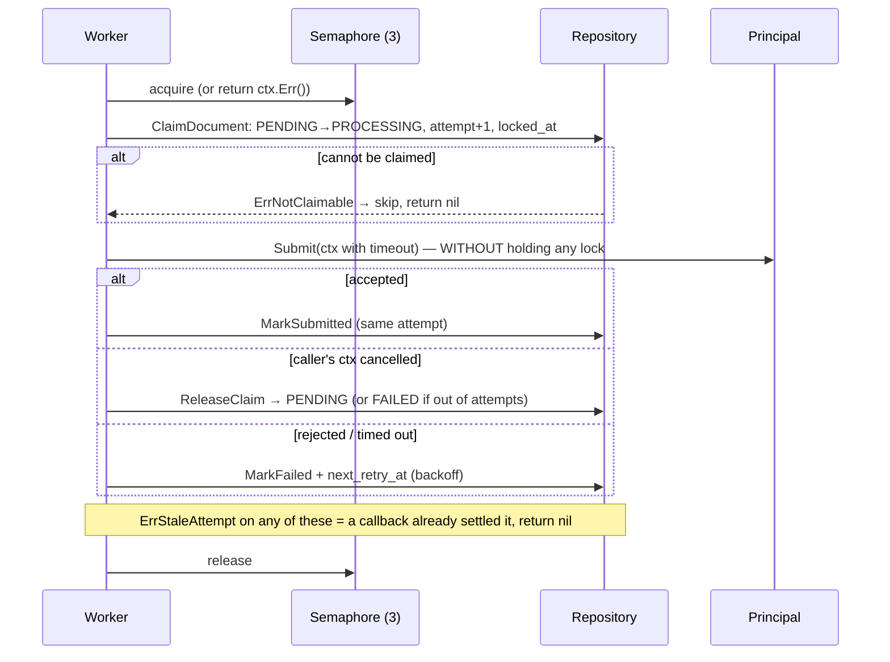

# docproc design

This document explains *why* the code is shaped the way it is. For how to
run it, see the [README](../README.md).

## The big picture

```
            ┌────────────── Service ───────────────┐
 client ──► │ CreateBatch      RetryFailed         │
            │ ProcessBatch ─► ProcessDocument ─────┼──► PrincipalClient.Submit ──► Principal
            │ GetBatchStatus   HandleCallback ◄────┼──── HTTP /v1/callbacks ◄────── (async)
            │ RecoverStale (periodic loop)         │
            └──────────────┬───────────────────────┘
                           │ Repository (interface)
                ┌──────────┴──────────┐
           memory.Repository   postgres.Repository
              (mutex)          (GORM + explicit SQL)
```

`Service` knows nothing about SQL or HTTP. Every concurrency rule that
concerns data (atomic claim, callback dedupe, fencing) is enforced in the
Repository, because only storage can guarantee it across goroutines **and**
across instances. The Service handles what belongs to the process: the
semaphore, timeouts, the order of steps, and cancellation.

## Document state machine



Compared with the table in the task there are three extra transitions, all
for failures midway:

- **PROCESSING → PENDING**: ctx cancelled during Submit, or the worker died
  and the lease expired. Without this transition the document would be stuck
  forever.
- **PROCESSING → FAILED** through the same paths, but when the attempts are
  used up. Putting it back to PENDING would create a PENDING document that
  can never be claimed (`attempt_count < max_attempts` fails) and a batch that
  never finishes.
- **PENDING → SUCCESS**: a SUCCESS callback from an earlier attempt that
  arrives after RetryFailed. See Assumptions in the README.

## ProcessDocument flow



Details that are easy to miss:

1. **Semaphore before claim.** In the opposite order (claim first, then wait
   for the semaphore), 100 documents could be PROCESSING while only 3 were
   actually sent. If the process died, the other 97 would have to wait for
   their lease to expire.
2. **Saving the result uses `context.WithoutCancel(ctx)`.** A cancelled ctx
   makes the `UPDATE` fail immediately and leaves the document in
   PROCESSING. The new ctx still gets a 5-second timeout so it does not hang
   if the database misbehaves.
3. **Telling "cancelled" from "rejected".** After a Submit error, what is
   checked is the **caller's** `ctx.Err()`, not the Submit error. The
   per-request timeout (`WithSubmitTimeout`) creates a child ctx that also
   ends with `DeadlineExceeded`, but that is a Principal failure (FAILED,
   retryable), not a cancellation from outside.
4. **The callback can win the race.** The Principal may send the callback
   before our side has recorded the Submit result, for example when our
   request times out after the Principal already accepted it. The fenced
   update then finds the document no longer PROCESSING at that attempt and
   returns `ErrStaleAttempt`. ProcessDocument treats that as "already
   settled": it returns nil and does not count a Submit failure.
5. **A panic in the client is caught** and treated as a failed Submit.
   Otherwise a single bug in a third-party SDK would crash the whole process
   and leave the document PROCESSING.

## Why claim per ID rather than per batch with LIMIT?

The task's contract requires `ProcessDocument(documentID)`, so a per-ID claim
has to exist anyway. `ProcessBatch` simply lists the PENDING IDs and hands
them to `ProcessDocument`. Consequences:

- If two instances process the same batch, both get the same list and race
  for the claims. The result is still correct (the claim is atomic), there
  are just wasted claims. `SKIP LOCKED` in the claim lets the loser move on
  to the next document without waiting.
- A document that goes back to PENDING after the list was taken (say
  RetryFailed runs at the same time) is not part of this round; the next
  `ProcessBatch` picks it up.

The chunked claim query (`q5_claim_pending_batch`) is ready in
`queries.sql` and is on the improvement list for multi-instance scale.

## Callbacks

```
BEGIN
  SELECT ... FROM documents WHERE id=$1 FOR UPDATE      -- 404 if missing; serialises per document
  INSERT INTO document_callbacks ... ON CONFLICT DO NOTHING RETURNING id
     0 rows → duplicate → COMMIT, done
  UPDATE documents ... WHERE id=$1 AND <allowed transition>
     SUCCESS: status <> 'SUCCESS'
     FAILED : status = 'PROCESSING'
COMMIT
```

A callback that is not applied (a late FAILED) **is still recorded**. Besides
auditing, that also keeps it from being processed again if the Principal
resends it.

`HandleCallback` answers success for duplicates. The Principal does not need
to know the difference, and returning an error for a duplicate would only
make the Principal keep resending.

## Recovery and shutdown

| Event | What happens to the document |
|---|---|
| ctx cancelled while waiting for the semaphore | stays PENDING, never touched |
| ctx cancelled during Submit | `ReleaseClaim` → PENDING (the attempt still counts) |
| SIGTERM | HTTP stops accepting requests → the work ctx is cancelled → as in the row above → wait for every goroutine → close the DB |
| Process killed (`SIGKILL`, OOM) after the claim | PROCESSING + `submitted_at` NULL → taken by `RecoverStale` once the lease expires |
| Process killed after Submit succeeded, before MarkSubmitted | same as above, but the Principal's callback usually arrives first and settles it |
| Submit succeeded, callback never arrives | stays PROCESSING with `submitted_at` set → needs reconciliation (not built yet, see improvements) |

## Concurrency limit: per instance

The task says "global, across the batches being processed in one instance".
A channel semaphore inside `Service` satisfies that: one `Service` per
process, and every `ProcessBatch` and `ProcessDocument` shares the same
channel. If the service is scaled to N instances, total requests to the
Principal become 3×N. If the Principal turns out to limit globally, the
limit has to move to shared storage (see the README).

## Security of the callback endpoint

Callbacks are verified with an HMAC-SHA256 of the raw body
(`X-Principal-Signature: sha256=<hex>`). The signature is checked before the
body is parsed, and `hmac.Equal` compares in constant time. Running without a
secret is only allowed together with the local simulator: when
`PRINCIPAL_URL` is set and `CALLBACK_SECRET` is not, the server refuses to
start, because an unsigned endpoint would let anyone mark documents SUCCESS.

## Testing

- **Service unit tests** (`docproc/*_test.go`) on top of the memory
  repository and a mock Principal. Every required test point from the task
  is here.
- **Repository contract tests** (`docproc/repotest`) run against memory and
  postgres. If the two ever behave differently, this suite catches it.
- **PostgreSQL integration tests**: the contract tests, end-to-end Service
  scenarios (parallel ProcessBatch + parallel duplicate callbacks), and
  verification of `queries.sql`.
- **HTTP tests**: status codes for every kind of bad input.
- **Config tests**: the server refuses unsafe or inconsistent configuration.
